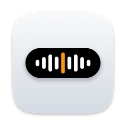

<div align="center">
  
  <h1>Voicer</h1>
  <p>Talk, and the words land where your cursor is. Local speech-to-text for macOS.</p>

  [](LICENSE)
  
</div>

---

Voicer is a fork of [VoiceInk](https://github.com/Beingpax/VoiceInk) by Pax, with a new look, a different way to
start and stop recording, and a meeting recorder. Speech is turned into text on your Mac by local models
(Parakeet, Whisper and others), so nothing you say has to leave the machine.

> **Want the original?** VoiceInk is a paid app with automatic updates and support from its author at
> [tryvoiceink.com](https://tryvoiceink.com). Buying it funds the work Voicer is built on.

## What Voicer changes

| Area | VoiceInk | Voicer |
|---|---|---|
| Recording key | Toggle or push to talk | **Hold or Double Tap**: hold Right Option to talk, double tap to keep recording hands-free until the next press |
| Waveform | Animated on a timer | Follows your voice, learns the room's background noise and stays flat in silence |
| Look | Default VoiceInk theme | Light cream theme with an orange accent, new icon, redesigned dashboard, history grouped by day |
| Meetings | Not available | Records your mic and the call's audio as two tracks, transcribes them locally, labels who said what and writes a summary |
| Call detection | Not available | Notices when a call app starts using the mic and offers to record the meeting |
| Menu bar | Dock or menu bar | Can also run with no Dock icon and the menu bar icon hidden |
| Upsell | Pro page, star prompts | Removed |
| Updates | Built-in updater | Off: the updater would install the paid VoiceInk over Voicer. Update by pulling new source and rebuilding |
| App ID | `com.prakashjoshipax.VoiceInk` | `com.ashadmohammed.Voicer`, so it can sit beside VoiceInk without sharing settings or history |

The meeting recorder and call detection are new and have had little real-world testing. Summaries need Apple
Intelligence. Bug reports are welcome.

## Build it

Requirements: macOS 15 or later, Xcode (with its Metal Toolchain: `xcodebuild -downloadComponent MetalToolchain`), Git.

```bash
git clone https://github.com/AshadMohammed/voicer.git
cd voicer
make local
open ~/Downloads/Voicer.app
```

`make local` builds the speech engine (whisper.cpp) for macOS only in `~/VoiceInk-Dependencies`, then builds Voicer
and copies `Voicer.app` to `~/Downloads`. Move it to `/Applications` and grant microphone and Accessibility access
when asked. More detail, including signing options, is in [BUILDING.md](BUILDING.md).

Without an Apple Development certificate the app is signed ad hoc, so macOS asks for permissions again after each
rebuild. There is no notarised download yet.

## Staying in step with VoiceInk

Voicer tracks upstream VoiceInk. New VoiceInk work is merged in, and Voicer's changes sit on top of it, so fixes
and new models from upstream keep arriving.

## License

GPL v3, the same as VoiceInk. See [LICENSE](LICENSE). VoiceInk is © Pax and its contributors; Voicer's changes are
© Ashad Mohammed. Bundled fonts (DM Sans, DM Serif Display, Space Grotesk) are under the SIL Open Font License; their
licence files sit next to them in `VoiceInk/Resources/Fonts`.

## Thanks

Everything here stands on [VoiceInk](https://github.com/Beingpax/VoiceInk) and the projects it credits:
[whisper.cpp](https://github.com/ggerganov/whisper.cpp), [FluidAudio](https://github.com/FluidInference/FluidAudio),
[TranscribeCpp for Swift](https://github.com/Beingpax/Transcribe-cpp-swift),
[KeyboardShortcuts](https://github.com/sindresorhus/KeyboardShortcuts),
[LaunchAtLogin](https://github.com/sindresorhus/LaunchAtLogin),
[MediaRemoteAdapter](https://github.com/ejbills/mediaremote-adapter), [Zip](https://github.com/marmelroy/Zip),
[SelectedTextKit](https://github.com/tisfeng/SelectedTextKit) and [Swift Atomics](https://github.com/apple/swift-atomics).
